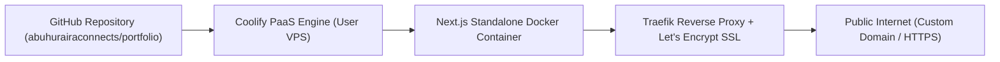

# Feature Specification: Abu Huraira Portfolio Platform

**Feature Branch**: `001-portfolio-core`  
**Status**: Approved / In-Execution  
**Created**: 2026-10-16  
**Target Deployment**: Coolify VPS (Docker Standalone)  

---

## 1. Executive Summary & Problem Statement

### 1.1 Problem Statement
Most developer portfolios suffer from two fatal extremes: either a generic, template-driven "AI vibe" (overused purple-blue gradients, 3 identical icon cards, fake stats, and empty buzzwords), or raw text resumes that fail to demonstrate real-world engineering depth. Potential clients, recruiters, and engineering leaders cannot discern whether the developer can architect robust, mission-critical production systems.

### 1.2 The Solution
A world-class, human-grade portfolio platform for **Abu Huraira** engineered with Next.js 15 (App Router), TypeScript, and Tailwind CSS. The platform showcases his unique dual-strength: **resilient full-stack software development** coupled with **next-generation AI & business automation**. Designed under strict **Anti-AI-Slop standards (Nutlope/hallmark 57 gates, Leonxlnx/taste-skill, ui-ux-pro-max)**, it highlights 3 real-world flagship systems, verified technical skills, and institutional training from **As-Sunnah Skill Development**.

---

## 2. In-Scope MVP vs Out-of-Scope (Boundaries)

### 2.1 In-Scope (MVP Phase 1)
- **Fluid Architectural Header**: Floating navigation with Monogram `AH`, clean anchor links, and a live "Available for opportunities" indicator.
- **Dynamic Hero Section**:
  - The 5 Core Roles dynamic typographic switcher:
    1. *Full-Stack Web Developer*
    2. *Software Developer*
    3. *Application Developer*
    4. *AI Automation Specialist*
    5. *AI Business Automation Consultant*
  - Authentic profile showcase (real photo, asymmetric morphing frame, zero fake badges).
  - Quick location context (Dhaka, Bangladesh · UTC+6) and primary CTA.
- **Asymmetric Bento Grid (Flagship Projects)**:
  - **Master Showcase (Project 1)**: *Madrasa Management System* (Full-stack Next.js/Prisma/Docker, live Render link, role-based dashboards).
  - **Secondary Flank (Project 2)**: *Joruri Rokto (জরুরি রক্ত)* (Zero-friction medical matching, ambulance hub, emergency healthtech).
  - **Interactive Innovation (Project 3)**: *Smart Bangla Voice Farm Accountant* (Interactive Bangla audio waveform & speech-to-ledger preview).
- **Dual-Root Skills & Background Matrix**:
  - Technical Stack: Categorized bento cards (Frontend, Backend & DB, DevOps, AI Pipelines).
  - Education & Values: As-Sunnah Skill Development, Islamic Studies & Ethics, Multidisciplinary Digital Media.
- **Inverted High-Contrast Contact Zone**:
  - Direct contact form powered by Next.js Server Action with client-side validation.
  - Direct connection links (GitHub, Email, LinkedIn, Telegram/WhatsApp).
- **Zero-Slop Assurance**: 100% adherence to Hallmark 57 gates (zero purple-blue clichés, zero fake browser frames, zero fabricated metrics).

### 2.2 Out-of-Scope (Deferred to Post-MVP)
- Full headless CMS with OAuth login (core data stays type-safe and resilient in TypeScript/JSON).
- Third-party analytics trackers with heavy cookie banners.
- Heavy Three.js 3D scenes that degrade Core Web Vitals on budget mobile devices.

---

## 3. Prioritized User Stories & Testing Scenarios

### User Story 1 - Brand Identity & Dynamic Hero (Priority: P1)
**User Goal**: As a tech lead or prospective client visiting the site, I want to immediately understand Abu Huraira's exact professional roles and senior-level expertise within 5 seconds without scrolling.

**Independent Test**: Load the landing viewport across 375px (mobile) and 1440px (desktop). Verify that all 5 roles rotate smoothly, the profile image renders sharply, and the primary CTA triggers smooth scroll.

**Acceptance Scenarios**:
1. **Given** a visitor lands on the homepage, **When** the page hydrates, **Then** the role headline smoothly cycles through the 5 specified titles with zero layout shift (CLS = 0).
2. **Given** a visitor clicks "Explore Work", **When** triggered, **Then** the viewport smoothly scrolls to the Bento Grid showcase.

---

### User Story 2 - Real-World Flagship Bento Showcase (Priority: P1)
**User Goal**: As an engineering recruiter, I want to inspect concrete proof of Abu Huraira's full-stack and architectural capabilities rather than reading theoretical lists.

**Independent Test**: Inspect the 3 featured project cards in the Bento Grid. Verify that every link, technology tag, and live demo pointer links to verified real projects.

**Acceptance Scenarios**:
1. **Given** the Madrasa Management card, **When** viewed, **Then** it presents the problem, solution, tech stack (Next.js, Node.js, Prisma, Docker), and verified links (Render live URL & GitHub).
2. **Given** the Joruri Rokto card, **When** clicked, **Then** it displays the emergency blood-matching architecture and zero-friction guest mode explanation.
3. **Given** the Smart Voice Farm card, **When** interacted with, **Then** it demonstrates the Bangla speech recognition workflow and SMS notification pipeline.

---

### User Story 3 - Technical Stack & As-Sunnah Training Matrix (Priority: P2)
**User Goal**: As a client looking for a disciplined developer, I want to review both his modern tech stack and his educational/ethical foundation.

**Independent Test**: Scroll to the Skills & Background section. Verify the presence of both modern engineering tools and the As-Sunnah Skill Development credentials.

**Acceptance Scenarios**:
1. **Given** the technical matrix, **When** inspected, **Then** skills are structured by domain (Frontend, Backend, DevOps, AI Automation) with semantic badges.
2. **Given** the Education & Foundation card, **When** viewed, **Then** As-Sunnah Skill Development is clearly featured alongside Islamic Studies and multidisciplinary competencies.

---

### User Story 4 - Resilient Inverted Contact Form (Priority: P2)
**User Goal**: As a hiring manager or client, I want to send an instant message or booking request directly from the footer without leaving the site.

**Independent Test**: Fill out the contact form with valid and invalid inputs; verify client-side validation errors, server action dispatch, and success feedback.

**Acceptance Scenarios**:
1. **Given** an invalid email address, **When** submitted, **Then** an accessible, inline error appears without reloading the page.
2. **Given** a valid message payload, **When** submitted, **Then** the Server Action executes, records the submission, and shows a confirmed success state in $<300$ms.

---

## 4. Architectural Data Models (TypeScript Contracts)

```typescript
export interface Project {
  id: string;
  slug: string;
  title: string;
  subtitle: string;
  category: 'Full-Stack' | 'AI Automation' | 'Healthcare/Social' | 'Developer Tools';
  featured: boolean;
  problem: string;
  solution: string;
  architectureHighlights: string[];
  techStack: string[];
  links: {
    live?: string;
    repo?: string;
    demo?: string;
  };
  metrics?: {
    label: string;
    value: string;
  };
}

export interface SkillGroup {
  category: string;
  description: string;
  items: {
    name: string;
    level?: string;
    icon?: string;
  }[];
}

export interface EducationBackground {
  institution: string;
  program: string;
  period: string;
  focus: string[];
}

export interface ContactSubmission {
  name: string;
  email: string;
  subject?: string;
  message: string;
  timestamp: string;
}
```

---

## 5. Non-Functional Requirements & Hallmark Quality Gates

| Metric | Target | Verification Method |
| :--- | :--- | :--- |
| **Lighthouse Performance** | $\ge 98$ | Chrome DevTools Lighthouse audit |
| **Cumulative Layout Shift (CLS)** | $0.00$ | Web Vitals report |
| **First Contentful Paint (FCP)** | $< 0.8$s | Network throttling simulation |
| **Mobile Responsiveness** | 375px, 768px, 1024px, 1440px+ | Zero horizontal scroll, touch-friendly touch targets ($\ge 44$px) |
| **Accessibility** | WCAG 2.1 AA | Color contrast ratio $\ge 4.5:1$ for text, keyboard navigable |
| **AI-Slop Gate** | Pass all 57 Hallmark Gates | Zero purple-blue gradient clichés, zero fake browser frames |

---

## 6. Deployment Architecture (Coolify VPS)


